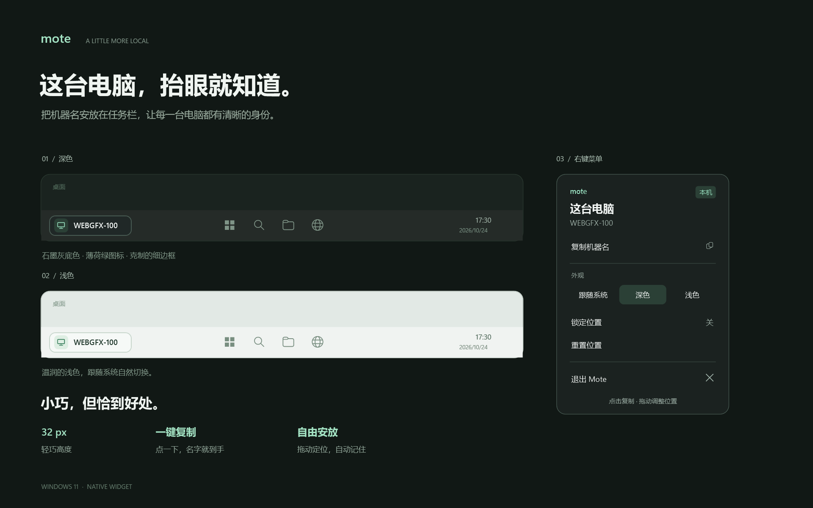

# mote

把机器名安放在 Windows 任务栏。



一个 32 px 高的原生 WPF 小组件：石墨灰圆角胶囊、薄荷绿电脑图标和真实机器名。内置深浅两套外观，默认跟随 Windows **任务栏**主题。

## 使用

从 [GitHub Releases](https://github.com/gyagp/mote/releases/latest) 下载 `Mote-v0.1.0-win-x64.zip`，解压后双击 `Mote.exe`。这是 Windows 11 x64 便携版，已包含 .NET 运行时，无需安装或管理员权限。

从源码运行需要 .NET 8 SDK：双击 `start.bat`，或执行下面的构建命令。开发用的 `dist` 输出需要 .NET 8 Desktop Runtime。

- 点击：复制机器名，文字短暂提亮反馈成功。组件只显示电脑图标和机器名，没有单独的复制按钮。
- 左右拖动：调整任务栏上的位置，自动保存。
- 右键：复制、切换外观、锁定位置、重置位置、退出。
- 重复启动不会产生多个组件。

设置保存到 `%LOCALAPPDATA%\Mote\settings.json`。不会修改 Explorer、注册开机启动或发送网络请求。

## 任务栏行为

Windows 11 没有公开的自定义文字任务栏组件接口。Mote 使用一个不抢焦点、不出现在 Alt+Tab 或任务按钮中的轻量浮窗，贴合**主显示器的水平任务栏**。

默认放在任务栏最左侧，保留 12 个逻辑像素的边距；通过 Windows UI Automation 读取按钮边界，如果左侧有系统控件，就选择最靠左且放得下的空白处。空间不足或无法读取边界时，显示在任务栏紧邻的桌面一侧。手动拖动以用户位置为准；右键“重置位置”恢复默认靠左和自动避让。

组件会跟随任务栏隐藏和重新出现，并在当前显示器的前台全屏应用中隐藏。每 250 ms 检查位置/显示状态，每 2 秒异步更新任务栏按钮边界。支持 DPI 缩放、分辨率变化与 Explorer 重启后的重新定位。不为任务栏预留空间，图标数量变化后可能短暂重叠，自动模式会在下一次扫描后调整。暂不支持副显示器和竖直任务栏。

## 开发和验证

```powershell
dotnet build Mote.csproj -c Release
dotnet run --project tests/Mote.Placement.Tests.csproj -c Release
dotnet publish Mote.csproj -c Release --no-self-contained -o dist
.\dist\Mote.exe --render artifacts
.\dist\Mote.exe --diagnose
```

`--render` 使用实际 WPF 控件输出设计图和深浅色组件 PNG；`--diagnose` 运行 4 秒，将任务栏检测、实际位置和 UI Automation 状态写入程序旁的 `diagnostics.json`，随后退出。诊断请在普通实例退出后运行。

布局测试覆盖拥挤任务栏、重叠按钮、负坐标、位置换算，以及 2,000 组随机布局的无碰撞约束。实际全屏切换、自动隐藏、不同 DPI 和 Explorer 重启仍需在相应桌面环境中手动验证。

## 制作发布包

在 Windows PowerShell 中运行：

```powershell
.\scripts\package.ps1
```

脚本运行布局测试，构建包含运行时的 Windows x64 单文件程序，并在 `.release` 中生成 ZIP 和 SHA-256 校验文件。首次启动时 .NET 会将内置原生库解压到用户临时目录。应用设置仍保存在 `%LOCALAPPDATA%\Mote`。
